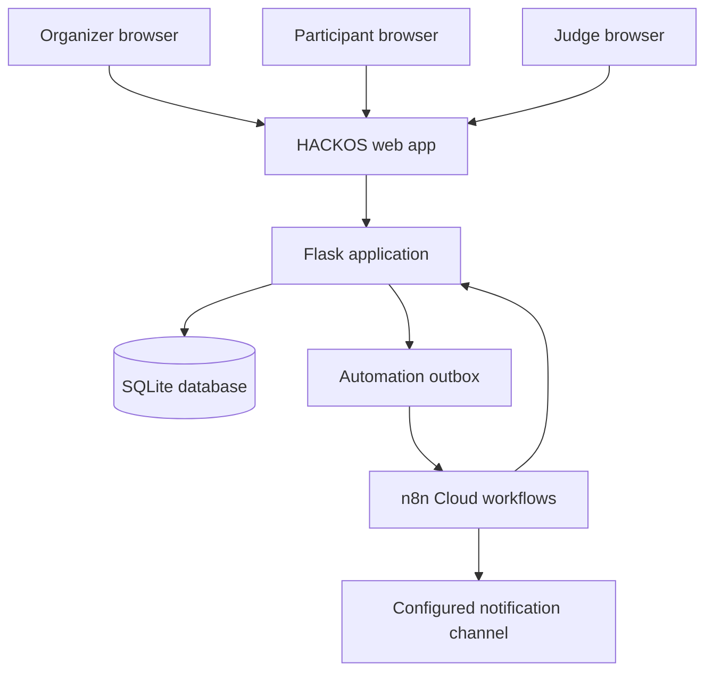
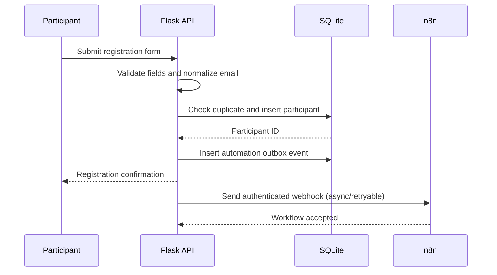
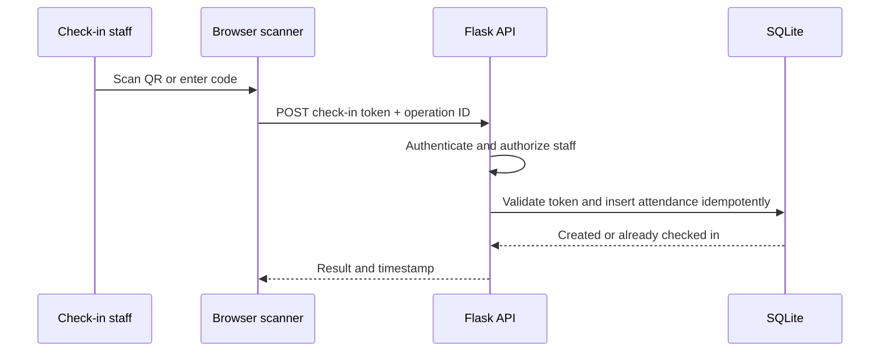
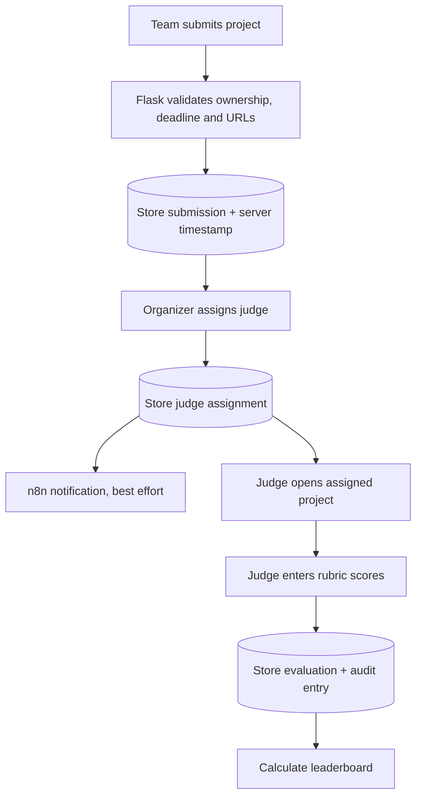

# HACKOS — System Architecture

**Version:** 1.0  
**Architecture style:** Modular monolith with an external workflow automation service  
**MVP stack:** Flask, SQLite, HTML/CSS/JavaScript, n8n Cloud

## 1. Architecture goals

- Deliver a working end-to-end prototype within the hackathon build window.
- Keep core event data and business rules in the Flask application.
- Use n8n for asynchronous notifications and scheduled automation, not as the primary database.
- Preserve a clean path from local SQLite prototype to a managed relational database later.
- Keep authorization and validation server-side.

## 2. System context

The Flask application owns authentication, authorization, validation, transactions, records and report generation. n8n receives only the minimum information required to perform a notification or scheduled task.

## 3. Recommended technology choices

| Layer | MVP choice | Responsibility |
|---|---|---|
| Frontend | HTML, CSS, vanilla JavaScript, Bootstrap or custom CSS | Role-specific UI and API requests |
| Backend | Python Flask | Routes, business rules, authentication and APIs |
| Data access | Flask-SQLAlchemy or parameterized SQLite access | Persistence and transaction boundaries |
| Database | SQLite | Local prototype data store |
| QR generation | Python `qrcode` package | Participant check-in QR creation |
| QR scanning | Browser camera library or manual-code fallback | Read participant token |
| Automation | n8n Cloud Pro | Notifications and scheduled reminders |
| Source control | Git and GitHub | Version control and submission repository |
| Testing | pytest and manual end-to-end checklist | Validation and regression tests |

These are implementation recommendations. The organizer's problem statement does not mandate a particular language or framework.

## 4. Logical modules

1. **Identity and access:** sign-in, session handling and role checks.
2. **Event configuration:** event name, timezone, deadlines, rules and rubric.
3. **Participants:** registration and participant profiles.
4. **Teams:** team records and membership changes.
5. **Attendance:** QR/code check-in and optional offline reconciliation.
6. **Communications:** announcements and schedule.
7. **Submissions:** project information, links, timestamps and status.
8. **Judging:** judge assignments, rubric and evaluations.
9. **Reporting:** CSV exports and leaderboard.
10. **Audit and automation:** audit history, webhook outbox and n8n integration.

## 5. Request and event flows

### 5.1 Registration

The transaction that creates the participant must not depend on n8n availability. If n8n fails, the outbox event remains retryable.

### 5.2 Check-in

### 5.3 Submission and judging

## 6. API design principles

- Use JSON for application APIs.
- Use consistent HTTP status codes.
- Authenticate every protected API request.
- Check role and resource ownership on every relevant endpoint.
- Validate input on the server even if the frontend validates it.
- Use pagination or result limits for list endpoints.
- Use idempotency keys/operation IDs for check-in and retryable actions.
- Return stable error shapes, for example `{ "error": { "code": "FORBIDDEN", "message": "..." } }`.

Suggested endpoint groups (names may be adapted during implementation):

| Method | Endpoint | Purpose | Access |
|---|---|---|---|
| POST | `/api/auth/login` | Sign in | Public |
| POST | `/api/auth/logout` | Sign out | Authenticated |
| GET/POST | `/api/participants` | List/create participants | Organizer |
| GET/PATCH | `/api/participants/{id}` | View/update participant | Organizer or owner, scoped |
| GET/POST | `/api/teams` | List/create teams | Organizer |
| POST | `/api/teams/{id}/members` | Add member | Organizer |
| POST | `/api/checkins` | Record check-in | Organizer/check-in role |
| GET/POST | `/api/announcements` | List/create announcements | Organizer for writes |
| GET/POST | `/api/schedule` | List/create schedule | Organizer for writes |
| GET/POST | `/api/submissions` | List/create submissions | Organizer; participant scoped for own team |
| POST | `/api/judge-assignments` | Assign judge | Organizer |
| GET | `/api/judging/assigned` | List assigned projects | Judge |
| POST | `/api/evaluations` | Submit score | Assigned judge |
| GET | `/api/reports/{type}` | Export CSV | Organizer |
| POST | `/api/internal/n8n/events` | Optional automation callback | Authenticated service only |

## 7. n8n integration pattern

### Trigger model

- Flask commits the business record first.
- Flask records a corresponding event in an `automation_outbox` table within the same transaction.
- A background task or controlled retry action sends the outbox payload to an n8n production webhook.
- Flask marks the outbox row as delivered or stores the failure and retry count.
- n8n performs the notification or scheduled automation and records execution status where possible.

### Initial workflows

1. `registration-confirmation`: Webhook → validate payload → send configured notification/log demo notification → respond.
2. `submission-reminders`: Schedule Trigger → authenticated request to Flask for pending teams → filter due reminders → send configured notification/log.
3. `judge-assignment-notification`: Webhook → look up minimal assignment details → notify judge/log.

Use n8n's production webhook URL only after activating/publishing the workflow. Store webhook URLs and secrets in server-side environment variables. Never embed secrets in JavaScript delivered to the browser.

### Failure behavior

- n8n timeout must not roll back core records.
- Retry with a bounded count and backoff.
- Avoid sending duplicate messages by using a stable event ID and deduplication.
- Make notification status visible to organizers if time permits.

## 8. Deployment topology

### Hackathon demo

- Flask runs locally or on a selected low-cost/free host.
- SQLite database is persisted in a protected application data directory.
- n8n runs in the sponsored n8n Cloud workspace.
- HTTPS is required for public deployment and camera access in browsers.
- Keep a local manual-code check-in option in case camera or network access fails.

### Future production direction

- Replace SQLite with PostgreSQL.
- Use managed application hosting and managed database backups.
- Add background worker/queue for outbox delivery.
- Add monitoring, structured logs and automated backups.
- Separate event tenancy and data retention policies.

## 9. Offline check-in design (P1)

1. Organizer loads a roster or obtains pre-issued signed check-in tokens while online.
2. Browser stores pending check-in operations locally with unique operation IDs.
3. UI labels them `Offline queued`; it does not claim server confirmation.
4. On reconnect, browser posts queued operations.
5. Server processes each operation idempotently and returns `created`, `already_checked_in`, `invalid` or `conflict`.
6. Browser marks successful operations synchronized and surfaces conflicts to staff.

Security note: do not store passwords or long-lived session secrets in local storage. Limit cached participant information and clear it after the event/session.

## 10. Scalability and trade-offs

- SQLite is appropriate for a single-instance hackathon prototype and modest demo traffic, not a guarantee of high-concurrency production behavior.
- A modular monolith is faster to build and easier to debug than microservices during a 24-hour event.
- n8n is suitable for orchestration, but critical synchronous business rules belong in Flask.
- Browser-based QR scanning depends on camera permissions and secure context; manual code entry is required as fallback.

## 11. Architecture decision records

| Decision | Chosen approach | Reason | Revisit when |
|---|---|---|---|
| Backend | Flask modular monolith | Fast implementation and simple deployment | Multiple independent teams/services are needed |
| Database | SQLite for MVP | Zero infrastructure and easy local demo | Concurrent load or multi-instance deployment is required |
| Automation | n8n Cloud | Sponsored access and visual workflow demonstration | Delivery volume or reliability needs require a queue/provider redesign |
| Offline scope | Check-in only, P1 | Most useful low-connectivity workflow in the brief | User research identifies other offline-critical operations |
| AI | Not required for core HACKOS | Problem focuses on reliable operations, not AI | A validated, explainable use case is identified |
