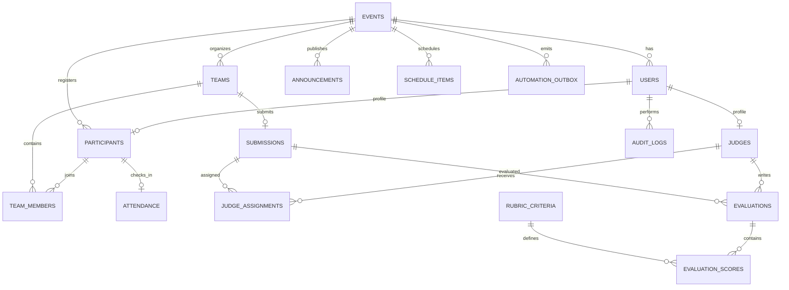

# HACKOS — Database Design

**Version:** 1.0  
**MVP database:** SQLite  
**Future migration target:** PostgreSQL

## 1. Database principles

- Use stable primary keys (UUID or integer IDs) and foreign keys.
- Enforce uniqueness and referential integrity in the database.
- Store timestamps in UTC; render them in the configured event timezone (recommended default: `Asia/Kolkata`).
- Store only information required to operate the hackathon.
- Use synthetic data in demos.
- Keep an audit trail for consequential changes.
- Use transactions for workflows that write to multiple related tables.

## 2. Entity relationship diagram

The ER diagram is logical. Exact cardinality and field names should match the implemented schema and database migrations.

## 3. Recommended tables

### 3.1 `events`

| Column | Type | Rules / purpose |
|---|---|---|
| `id` | TEXT/UUID | Primary key |
| `name` | TEXT | Required event name |
| `slug` | TEXT | Unique event slug |
| `timezone` | TEXT | Required IANA timezone, e.g. `Asia/Kolkata` |
| `starts_at` | DATETIME | Nullable until configured |
| `ends_at` | DATETIME | Nullable until configured |
| `submission_deadline` | DATETIME | Nullable; server-side deadline |
| `team_size_min` | INTEGER | Positive; optional event rule |
| `team_size_max` | INTEGER | Positive; must be >= min when both set |
| `settings_json` | TEXT | Optional event settings; validate shape in app |
| `created_at` | DATETIME | Required UTC timestamp |

### 3.2 `users`

| Column | Type | Rules / purpose |
|---|---|---|
| `id` | TEXT/UUID | Primary key |
| `event_id` | TEXT/UUID | Foreign key to event; scope access |
| `email` | TEXT | Required; normalized; unique within event |
| `password_hash` | TEXT | Required; never plaintext |
| `role` | TEXT | `organizer`, `participant`, `judge` |
| `is_active` | BOOLEAN | Default true |
| `created_at` | DATETIME | Required |
| `updated_at` | DATETIME | Required |

### 3.3 `participants`

| Column | Type | Rules / purpose |
|---|---|---|
| `id` | TEXT/UUID | Primary key |
| `event_id` | TEXT/UUID | Foreign key |
| `user_id` | TEXT/UUID | Nullable FK to users if participant has login |
| `participant_code` | TEXT | Unique, non-guessable check-in identifier |
| `full_name` | TEXT | Required |
| `email_normalized` | TEXT | Required; unique within event |
| `phone` | TEXT | Optional; collect only if needed |
| `institution` | TEXT | Optional |
| `registration_status` | TEXT | `pending`, `confirmed`, `cancelled`, `flagged_duplicate` |
| `created_at` | DATETIME | Required |
| `updated_at` | DATETIME | Required |

### 3.4 `teams`

| Column | Type | Rules / purpose |
|---|---|---|
| `id` | TEXT/UUID | Primary key |
| `event_id` | TEXT/UUID | Foreign key |
| `team_code` | TEXT | Unique within event |
| `name` | TEXT | Required |
| `problem_statement` | TEXT | HACKOS PS or selected challenge |
| `status` | TEXT | e.g. `active`, `withdrawn` |
| `created_at` | DATETIME | Required |
| `updated_at` | DATETIME | Required |

### 3.5 `team_members`

| Column | Type | Rules / purpose |
|---|---|---|
| `id` | TEXT/UUID | Primary key |
| `team_id` | TEXT/UUID | FK to teams |
| `participant_id` | TEXT/UUID | FK to participants |
| `member_role` | TEXT | Optional, e.g. `leader`, `member` |
| `joined_at` | DATETIME | Required |
| `left_at` | DATETIME | Nullable; retain history |

Recommended integrity rule: prevent two active memberships for the same participant in the same event unless event policy explicitly allows it.

### 3.6 `attendance`

| Column | Type | Rules / purpose |
|---|---|---|
| `id` | TEXT/UUID | Primary key |
| `event_id` | TEXT/UUID | FK to events |
| `participant_id` | TEXT/UUID | FK to participants; unique per event for one-time check-in |
| `checked_in_at` | DATETIME | Server timestamp |
| `checked_in_by` | TEXT/UUID | FK to organizer/staff user |
| `operation_id` | TEXT | Idempotency key; unique when provided |
| `source` | TEXT | `qr`, `manual`, `offline_sync` |
| `created_at` | DATETIME | Required |

Use a unique constraint on `(event_id, participant_id)` for a one-time attendance model. If multiple sessions/check-ins are required later, add a session identifier to the uniqueness rule.

### 3.7 `announcements`

| Column | Type | Rules / purpose |
|---|---|---|
| `id` | TEXT/UUID | Primary key |
| `event_id` | TEXT/UUID | FK to events |
| `title` | TEXT | Required |
| `body` | TEXT | Required; render safely |
| `status` | TEXT | `draft`, `published`, `archived` |
| `published_at` | DATETIME | Nullable until published |
| `created_by` | TEXT/UUID | FK to users |
| `created_at` | DATETIME | Required |
| `updated_at` | DATETIME | Required |

### 3.8 `schedule_items`

| Column | Type | Rules / purpose |
|---|---|---|
| `id` | TEXT/UUID | Primary key |
| `event_id` | TEXT/UUID | FK to events |
| `title` | TEXT | Required |
| `description` | TEXT | Optional |
| `starts_at` | DATETIME | Required |
| `ends_at` | DATETIME | Required; validate after start |
| `location` | TEXT | Optional |
| `status` | TEXT | `draft`, `published`, `cancelled` |
| `created_by` | TEXT/UUID | FK to users |
| `created_at` | DATETIME | Required |

### 3.9 `submissions`

| Column | Type | Rules / purpose |
|---|---|---|
| `id` | TEXT/UUID | Primary key |
| `event_id` | TEXT/UUID | FK to events |
| `team_id` | TEXT/UUID | FK to teams; unique per event for one final submission |
| `project_title` | TEXT | Required |
| `description` | TEXT | Required, with length limit |
| `repository_url` | TEXT | Required/optional according to event settings; validate URL |
| `demo_url` | TEXT | Optional; validate URL |
| `status` | TEXT | `submitted`, `late`, `locked`, `withdrawn` |
| `submitted_at` | DATETIME | Server-generated authoritative timestamp |
| `updated_at` | DATETIME | Server-generated |
| `updated_by` | TEXT/UUID | FK to users |

If multiple submission versions are needed, use a separate `submission_versions` table instead of overwriting prior versions.

### 3.10 `judges`

| Column | Type | Rules / purpose |
|---|---|---|
| `id` | TEXT/UUID | Primary key |
| `event_id` | TEXT/UUID | FK to events |
| `user_id` | TEXT/UUID | FK to users |
| `display_name` | TEXT | Required |
| `expertise` | TEXT | Optional category/skills description |
| `created_at` | DATETIME | Required |

### 3.11 `judge_assignments`

| Column | Type | Rules / purpose |
|---|---|---|
| `id` | TEXT/UUID | Primary key |
| `event_id` | TEXT/UUID | FK to events |
| `submission_id` | TEXT/UUID | FK to submissions |
| `judge_id` | TEXT/UUID | FK to judges |
| `status` | TEXT | `assigned`, `accepted`, `completed`, `revoked` |
| `assigned_by` | TEXT/UUID | FK to users |
| `assigned_at` | DATETIME | Required |

Recommended unique constraint: `(submission_id, judge_id)` for one active assignment per judge/project.

### 3.12 `rubric_criteria`

| Column | Type | Rules / purpose |
|---|---|---|
| `id` | TEXT/UUID | Primary key |
| `event_id` | TEXT/UUID | FK to events |
| `name` | TEXT | Required |
| `description` | TEXT | Optional |
| `max_score` | DECIMAL | Positive value |
| `weight` | DECIMAL | Optional; if used, define a consistent total/normalization rule |
| `display_order` | INTEGER | Stable ordering |
| `is_active` | BOOLEAN | Default true |

### 3.13 `evaluations`

| Column | Type | Rules / purpose |
|---|---|---|
| `id` | TEXT/UUID | Primary key |
| `event_id` | TEXT/UUID | FK to events |
| `submission_id` | TEXT/UUID | FK to submissions |
| `judge_id` | TEXT/UUID | FK to judges |
| `status` | TEXT | `draft`, `submitted`, `reopened` |
| `comments` | TEXT | Optional feedback |
| `total_score` | DECIMAL | Calculated server-side |
| `submitted_at` | DATETIME | Nullable until submitted |
| `created_at` | DATETIME | Required |
| `updated_at` | DATETIME | Required |

Recommended unique constraint: `(submission_id, judge_id)` unless multiple rounds are explicitly supported.

### 3.14 `evaluation_scores`

| Column | Type | Rules / purpose |
|---|---|---|
| `id` | TEXT/UUID | Primary key |
| `evaluation_id` | TEXT/UUID | FK to evaluations |
| `criterion_id` | TEXT/UUID | FK to rubric criteria |
| `score` | DECIMAL | Must be between zero and criterion maximum |
| `comment` | TEXT | Optional criterion-level note |

Recommended unique constraint: `(evaluation_id, criterion_id)`.

### 3.15 `audit_logs`

| Column | Type | Rules / purpose |
|---|---|---|
| `id` | TEXT/UUID | Primary key |
| `event_id` | TEXT/UUID | FK to events |
| `actor_user_id` | TEXT/UUID | FK to users; nullable only for controlled system actions |
| `action` | TEXT | e.g. `participant.updated`, `team.member_removed`, `score.submitted` |
| `entity_type` | TEXT | Entity name |
| `entity_id` | TEXT | ID of affected entity |
| `before_json` | TEXT | Optional redacted before state |
| `after_json` | TEXT | Optional redacted after state |
| `created_at` | DATETIME | Required server timestamp |

Never store password hashes, session tokens, webhook secrets or unnecessary sensitive values in audit JSON.

### 3.16 `automation_outbox`

| Column | Type | Rules / purpose |
|---|---|---|
| `id` | TEXT/UUID | Primary key and stable event ID |
| `event_id` | TEXT/UUID | FK to events |
| `event_type` | TEXT | e.g. `registration.created`, `judge.assigned` |
| `payload_json` | TEXT | Minimum required payload; no secrets |
| `status` | TEXT | `pending`, `sent`, `failed`, `dead_letter` |
| `attempt_count` | INTEGER | Default 0 |
| `next_attempt_at` | DATETIME | Nullable retry schedule |
| `last_error` | TEXT | Sanitized error only |
| `created_at` | DATETIME | Required |
| `sent_at` | DATETIME | Nullable |

## 4. Core relationships and constraints

- One event has many participants, teams, announcements, schedule items and submissions.
- A team has many membership history rows; only active rows count toward current membership.
- A participant should have at most one active team membership unless event rules say otherwise.
- A participant can have one attendance record per event for a one-time check-in model.
- A team has at most one current submission in the MVP.
- A submission can have multiple judge assignments and evaluations.
- Each evaluation has at most one score per active rubric criterion.
- An evaluation must be created by a judge assigned to that submission.
- All record access must be scoped to the relevant event.

## 5. Index recommendations

Create indexes for:

- `users(event_id, email)` unique.
- `participants(event_id, email_normalized)` unique.
- `participants(event_id, participant_code)` unique.
- `teams(event_id, team_code)` unique.
- `team_members(team_id, left_at)`.
- `attendance(event_id, participant_id)` unique.
- `submissions(event_id, team_id)` unique for one submission per team.
- `judge_assignments(judge_id, status)`.
- `evaluations(submission_id, judge_id)` unique.
- `audit_logs(event_id, created_at)`.
- `automation_outbox(status, next_attempt_at)`.

## 6. Data lifecycle

- Use synthetic demo records wherever possible.
- Restrict exports to organizers.
- Define a retention period before using real event data.
- Remove or anonymize unnecessary personal information after the event according to organizer policy.
- Back up the SQLite database before major schema changes or final demos.

## 7. Scoring calculation recommendation

The organizer's PS requires a configurable rubric and score capture but does not prescribe a formula. Recommended MVP approach:

1. Validate every score against its criterion's maximum.
2. Normalize each criterion to its configured contribution/weight.
3. Sum criterion contributions to produce one judge total.
4. Average submitted judge totals for the project.
5. Display how many assigned judges have submitted evaluations.
6. Define tie handling and treatment of incomplete evaluations in the event settings.

Do not silently treat missing scores as zero unless that is the explicitly selected event rule.
